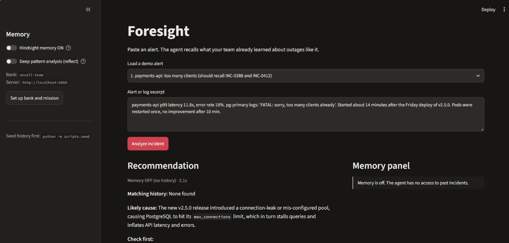
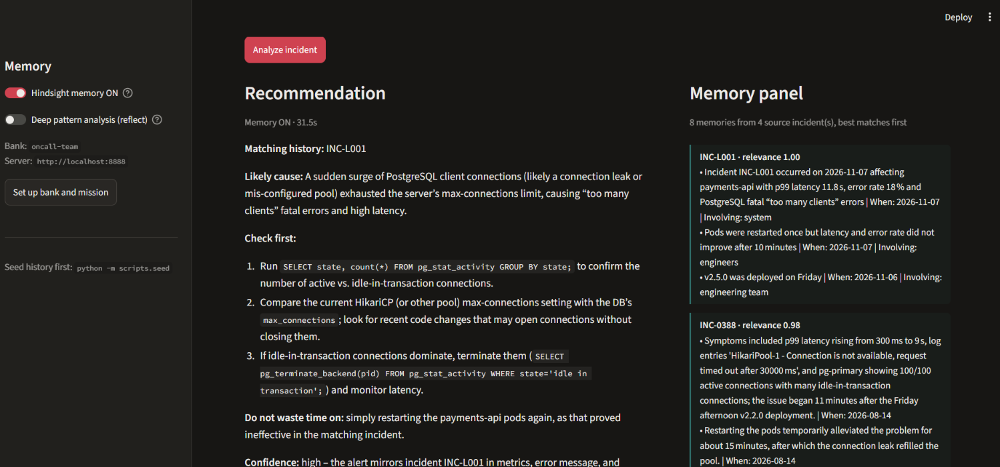
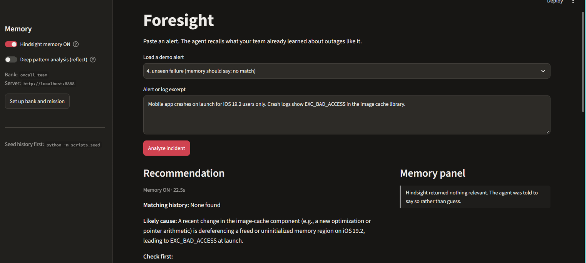
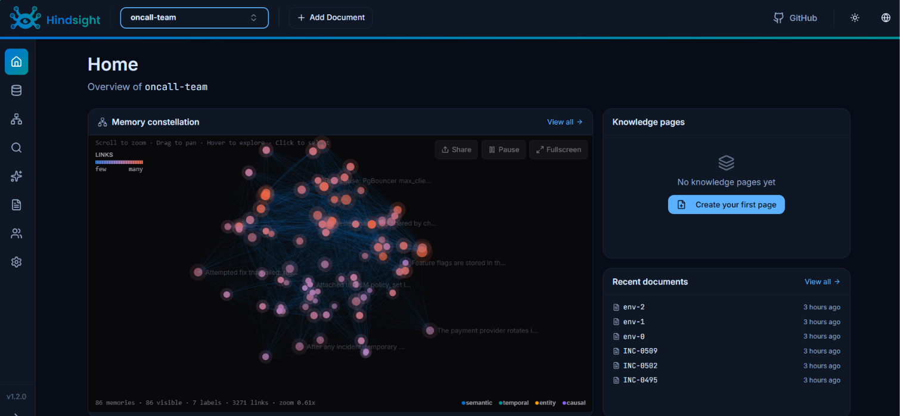
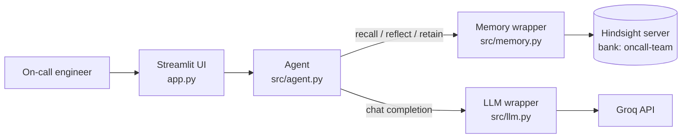

# Foresight

> **The on-call copilot that remembers every outage.**
> Hindsight gives it memory; that memory gives you foresight.

On-call engineers keep re-learning the same outages. The root cause of last month's incident sits in a
post-mortem nobody reads at 2 a.m., and the most expensive minutes go to fixes the team already knows
fail. Foresight is an incident-response agent that recalls similar past incidents, says what fixed them,
says what **did not**, and learns from the engineer's correction afterwards.

Built with [Hindsight](https://github.com/vectorize-io/hindsight) for long-term memory and
[Groq](https://groq.com/) for the LLM.

---

## See it work

### 1. Without memory: generic advice
Same alert, memory switched off. The answer is reasonable but could be about any Postgres outage.



### 2. With memory: grounded in your team's history
The agent recalls the incident it has seen before and the engineer feedback saved after it. The Memory
panel shows exactly which incidents informed the answer, with a relevance score for each. Note
**INC-L001**: that is a correction an engineer typed into the app earlier, and it is already being
recalled for the next similar alert.



### 3. When there is no history, it says so
For a failure the team has never seen, Hindsight returns nothing above the relevance floor and the agent
answers **"Matching history: None found"** instead of borrowing lessons from unrelated incidents.



### 4. The memory behind it
Fourteen seeded documents (11 incident post-mortems and 3 environment facts) became 86 linked memories
in the Hindsight bank, connected by semantic, temporal, entity and causal links.



---

## How it works



1. The engineer pastes an alert.
2. **Recall:** Hindsight returns the most relevant memories, with their source incident and a relevance score.
3. The agent groups them by incident and asks the LLM for a structured answer: matching history, likely
   cause, what to check first, what **not** to waste time on, and confidence.
4. After the incident, the engineer records the real root cause and what failed. That is **retained** in
   Hindsight and shows up on the next similar alert.

## How Hindsight memory is used

| Hindsight operation | Where | What it does |
|---|---|---|
| `create_bank`, `update_bank_config` | `src/memory.py` | SRE-specific mission and a skeptical disposition |
| `retain` | `scripts/seed.py`, `src/agent.py` | Post-mortems, environment facts, and live engineer feedback |
| `recall` | `src/agent.py` | Finds past incidents, even when worded differently from the alert |
| `reflect` | `src/agent.py` (optional toggle) | Reasons across incidents to find recurring patterns |

Details and the full before/after story: [docs/HINDSIGHT_USAGE.md](docs/HINDSIGHT_USAGE.md).

## Quick start

**You need:** Docker Desktop, Python 3.10+, and a [Groq API key](https://console.groq.com/).

**1. Install**
```bash
git clone https://github.com/iamshubham18/foresight-oncall.git
cd foresight-oncall
python -m venv .venv
# macOS/Linux: source .venv/bin/activate     Windows PowerShell: .venv\Scripts\Activate.ps1
pip install -r requirements.txt
```

**2. Configure.** Two files hold your key. Both are git-ignored.

`.env` (read by the app):
```
GROQ_API_KEY=your_key
GROQ_MODEL=openai/gpt-oss-120b
GROQ_FALLBACK_MODEL=
HINDSIGHT_URL=http://localhost:8888
HINDSIGHT_BANK_ID=oncall-team
RECALL_MIN_RERANKER=0.1
RECALL_MAX_MEMORIES=8
```

`hindsight.env` (read by the Hindsight container):
```
HINDSIGHT_API_LLM_PROVIDER=groq
HINDSIGHT_API_LLM_API_KEY=your_key
HINDSIGHT_API_LLM_MODEL=openai/gpt-oss-120b
HINDSIGHT_API_LLM_GROQ_SERVICE_TIER=on_demand
```
`on_demand` is needed on Groq accounts without the `auto` service tier.

**3. Start Hindsight** (leave this terminal running)
```bash
docker run --rm -it --pull always -p 8888:8888 -p 9999:9999 --env-file hindsight.env \
  -v "$HOME/.hindsight-docker:/home/hindsight/.pg0" ghcr.io/vectorize-io/hindsight:latest
```
The memory browser opens at <http://localhost:9999>. Check the
[Hindsight docs](https://hindsight.vectorize.io/) if flags have changed.

**4. Verify the stack, then load the incident history** (second terminal, venv active)
```bash
python -m scripts.smoke_test
python -m scripts.seed
```
Seeding is throttled to fit Groq's free-tier token limit and takes roughly 15 minutes. It is resumable:
progress is stored in `.seed_done.json`, so re-running continues where it stopped.

**5. Run the app**
```bash
streamlit run app.py
```

## Try the demo

Use the "Load a demo alert" menu:

| Alert | What it shows |
|---|---|
| 1. payments-api: too many clients | Recalls INC-0388 and what failed there; compare with memory switched off |
| 2. checkout: carts vanishing | Recalls the shared-Redis incident and warns that restarting Redis wipes carts |
| 3. orders lag growing | Recalls the Kafka rebalance incident and warns that adding pods made it worse |
| 4. unseen failure | Answers "None found" instead of guessing |

Then use **Teach the agent** to save a correction and run the same alert again.

On Groq's free tier, wait about a minute between runs. In my runs an answer took roughly 7 to 30 seconds,
longer when the rate limit kicked in.

## Design notes

- **Memories are grouped by source incident before they reach the LLM.** My first version passed 60 loose
  facts and the agent blamed a DNS fix from one incident on an unrelated database outage. Labelling each
  fact with its incident, and telling the model never to mix them, fixed it.
- **Recall always returns the nearest neighbours, even when nothing is relevant.** A relevance floor
  (`RECALL_MIN_RERANKER=0.1`) lets Hindsight abstain. On my four demo alerts, real matches scored 0.2 and
  above and unrelated memories 0.03 and below. That is a small sample, so
  `python -m scripts.probe_scores` prints the scores for you to re-check on your own data.
- **Failed fixes are first-class memory.** "Restarting only helped for 15 minutes" is often the most
  valuable and least documented fact.
- **No tool calling.** The app decides when to recall, so there is no malformed tool-call JSON to handle.

## Project layout

```
app.py              Streamlit UI (memory toggle, memory panel, feedback form)
src/memory.py       All Hindsight calls
src/agent.py        Recall, prompt assembly, feedback retention
src/llm.py          Groq client with retry and rate-limit waiting
data/               Synthetic incident history and demo alerts
scripts/            seed, smoke_test, probe_scores
docs/               PRD, roadmap, architecture, Hindsight usage, test plan, demo script
```

## Documentation

[Product requirements](docs/PRD.md) · [Roadmap](docs/ROADMAP.md) · [Architecture](docs/ARCHITECTURE.md) ·
[Hindsight usage](docs/HINDSIGHT_USAGE.md) · [Test plan](docs/TEST_PLAN.md) · [Demo script](docs/DEMO_SCRIPT.md)

## Limitations

- The incident history is **synthetic**, written to look like a mid-size e-commerce platform.
- Alerts are pasted in; there are no PagerDuty, Datadog or Slack integrations yet.
- The agent advises, a human acts. It never runs remediation.
- One shared memory bank and no authentication. It is built for local use.
- The relevance cutoff was tuned on four demo alerts and needs re-tuning on real data.

## Next

Contradiction handling (flag a past fix as stale when new feedback says it stopped working), source
incident links in the memory panel, alert intake from webhooks, and an auto-drafted post-mortem that is
retained back into memory. See the [roadmap](docs/ROADMAP.md).

---

Built with [Hindsight](https://github.com/vectorize-io/hindsight) ·
[Hindsight docs](https://hindsight.vectorize.io/) ·
[What is agent memory?](https://vectorize.io/what-is-agent-memory)
