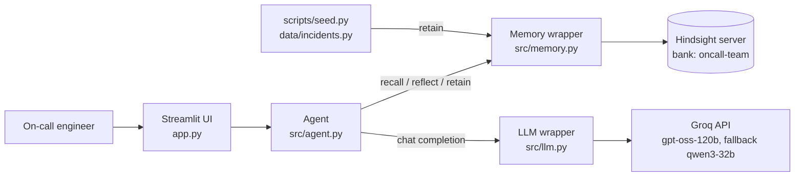
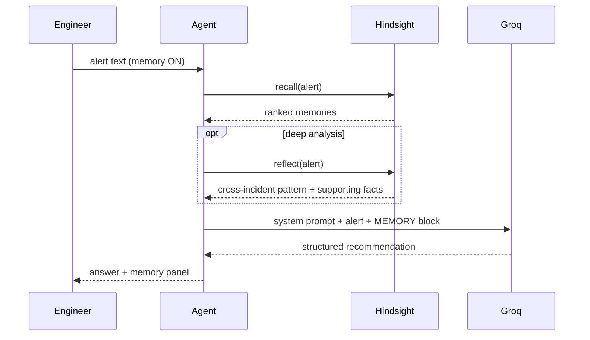
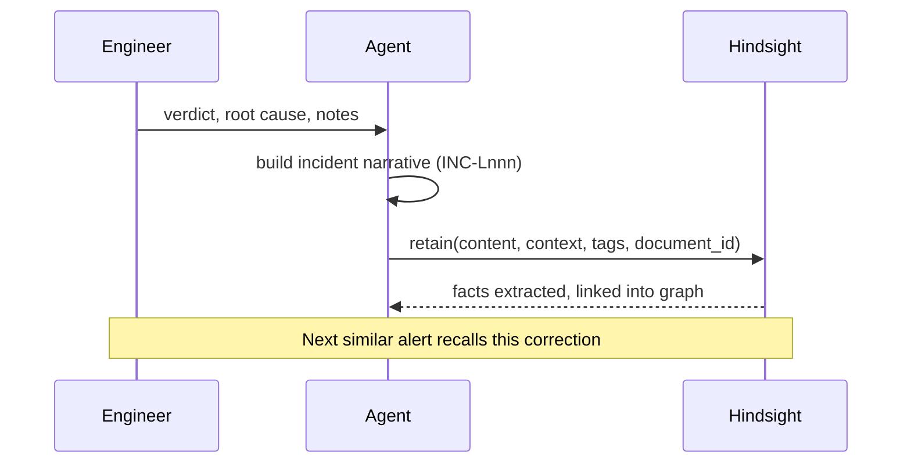

# Architecture

## 1. Overview
Foresight is a thin application around two services: **Hindsight** (memory) and **Groq** (LLM).
The app never stores incident history itself; Hindsight is the single source of truth.

## 2. Components
| Component | File | Responsibility |
|---|---|---|
| UI | `app.py` | Alert input, recommendation, memory panel, feedback form, toggles |
| Agent | `src/agent.py` | Orchestrates recall, optional reflect, prompt assembly, feedback retention |
| Memory wrapper | `src/memory.py` | The only code that talks to Hindsight |
| LLM wrapper | `src/llm.py` | Groq calls with retry and model fallback |
| Data | `data/` | Synthetic incidents, environment facts, demo alerts |
| Scripts | `scripts/` | `seed.py` (load history), `smoke_test.py` (verify stack) |

## 3. Flows
### 3.1 Analyze an alert

With memory OFF, the recall and reflect steps are skipped and Groq sees only the alert.

### 3.2 Learn from feedback

## 4. Memory design
**One bank** (`oncall-team`) holds everything; env var `HINDSIGHT_BANK_ID` overrides it.

**What is retained**, as natural-language narratives (Hindsight extracts facts and entities with its LLM):
- Post-mortems: incident ID, date, service, symptoms, confirmed root cause, fix that worked, **fixes that failed**, notes
- Environment facts: deploy schedules, shared infrastructure
- Live feedback: engineer verdict and correction, as `INC-Lnnn`

**Tags:** `service:*`, `sev:*`, `source:postmortem|env|feedback`, `incident:*`
**`document_id`:** the incident ID, so re-seeding does not create duplicates.

**Bank configuration** (`setup_bank`): `retain_mission` (what to keep), `reflect_mission` (senior-SRE persona),
`disposition_skepticism=4` (doubt old fixes), `disposition_empathy=1` (facts over feelings).

## 5. Key design decisions
| Decision | Why | Trade-off |
|---|---|---|
| Plain chat completions, no tool calling | Avoids malformed tool-call failures the organisers warned about | The app, not the model, decides when to recall (always, when memory is ON) |
| Recall every time, reflect only on request | Recall is fast and gives a visible panel; reflect is slower | Pattern insights are opt-in |
| Failed fixes are first-class in the narrative | "What NOT to try" is the highest-value, least-documented knowledge | Longer retained text per incident |
| Narrative text rather than structured JSON | Hindsight's extraction works on natural language | Less strict schema |
| Single wrapper file for Hindsight | Easy to read, screenshot, and swap | None significant at this size |
| Memory toggle in the app | Makes before/after provable to judges | Adds one branch in the agent |

## 6. Failure handling
| Failure | Behaviour |
|---|---|
| Hindsight unreachable | Recall error is caught; the answer says memory is unavailable. Feedback save shows an error |
| Groq error / rate limit | Retry twice per model, then fall back to the second model, then raise a clear error |
| Empty recall | The prompt tells the model to state there is no matching history |
| `<think>` blocks from Qwen | Stripped before display |
| Duplicate seeding | `document_id` makes retain an upsert |

## 7. Configuration
| Variable | Purpose | Default |
|---|---|---|
| `GROQ_API_KEY` | Groq credentials | required |
| `GROQ_MODEL` / `GROQ_FALLBACK_MODEL` | Primary and fallback models | `openai/gpt-oss-120b` / `qwen/qwen3-32b` |
| `HINDSIGHT_URL` | Hindsight API | `http://localhost:8888` |
| `HINDSIGHT_BANK_ID` | Memory bank | `oncall-team` |

The Hindsight **server** also needs its own LLM key (for fact extraction and reflect), set via `HINDSIGHT_API_*` environment variables.

## 8. Known limitations
- Recall returns what Hindsight ranks as relevant; the app does not yet re-rank or filter by service.
- No staleness detection yet (Phase 2).
- No authentication; intended for local or demo use.
- Synthetic data only.
